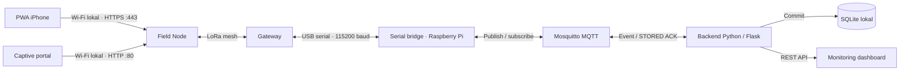

<div align="center">


# RescueNet V2

### Tetap terhubung di lapangan, bahkan tanpa internet.

Sistem komunikasi darurat dan monitoring lokal yang menghubungkan<br>
**SOS · lokasi GPS · jaringan LoRa mesh · pusat komando**


[Tentang proyek](#tentang-proyek) · [Tampilan](#tampilan) · [Arsitektur](#arsitektur) · [Mulai](#mulai) · [Dokumentasi](#dokumentasi)

</div>

---

## Tentang proyek

RescueNet adalah proyek capstone komunikasi darurat untuk kondisi lapangan ketika internet tidak tersedia di perangkat pengguna. Pengguna terhubung ke Wi-Fi **Field Node**, mengirim laporan atau SOS, lalu jaringan **LoRa mesh** meneruskannya ke **Gateway**. Raspberry Pi menerima data melalui USB serial, menyimpannya secara lokal, dan menyajikan dashboard untuk monitoring serta koordinasi.

Repository ini memuat seluruh bagian sistem: firmware Field Node dan Gateway, PWA untuk iPhone, source aplikasi native React Native/Expo, backend Python, dashboard web, protokol komunikasi, dan pengujian.

| Kebutuhan | Bagaimana RescueNet menanganinya |
| --- | --- |
| Mengirim bantuan tanpa internet di ponsel | Wi-Fi lokal Field Node, captive portal HTTP, dan API HTTPS untuk PWA |
| Meneruskan laporan antarnode | LoRa mesh dengan pencarian Gateway, antrean, dan retry |
| Mendahulukan keadaan darurat | Prioritas trafik SOS dibandingkan trafik aplikasi biasa |
| Memantau lokasi dan laporan | Penyimpanan SQLite lokal, API Flask, serta dashboard dengan peta Leaflet |
| Mengetahui tahap pengiriman | Penerimaan Field Node dipisahkan dari konfirmasi penyimpanan server |

> Tanpa internet bukan berarti tanpa jaringan: ponsel tetap harus terhubung ke Wi-Fi Field Node, dan jalur mesh–Gateway–server harus tersedia. Waktu kirim radio bergantung pada kondisi lapangan; proyek ini tidak menjamin waktu tiba SOS atau respons petugas.

## Tampilan

Dashboard memakai identitas navy/biru RescueNet, navigasi yang konsisten, kartu status yang mudah dibaca, dan layout responsif.


*Screenshot dari aplikasi yang berjalan dengan database uji sementara. Angka, koordinat, dan status pada gambar adalah data fixture, bukan telemetri perangkat nyata.*

<details>
<summary><strong>Lihat Mesh Nodes, Emergency Reports, dan GPS Map</strong></summary>

### Mesh Nodes


Animasi garis mengikuti status yang dilaporkan. Garis bukan pengukuran rute relay atau pergerakan paket radio.

### Emergency Reports


### GPS Map


Ketiga screenshot juga menggunakan data uji sementara.

</details>

## Arsitektur



Gateway meneruskan paket melalui USB serial; **serial bridge di Raspberry Pi**, bukan firmware Gateway, yang berkomunikasi dengan MQTT. Backend menerima event dari MQTT dan menerbitkan ACK setelah data tersimpan. ACK kembali melalui Gateway dan LoRa ke Field Node.

| Bagian | Tanggung jawab utama |
| --- | --- |
| **Field Node** | Wi-Fi AP, captive portal, API HTTPS, GPS perangkat, antrean laporan/SOS, dan pengiriman mesh |
| **Gateway** | Menerima payload mesh, meneruskannya ke serial, dan mengembalikan ACK server |
| **Serial bridge** | Parsing frame, normalisasi data, pengiriman ke MQTT, serta penyaluran ACK ke Gateway |
| **Backend** | Validasi, deduplikasi, penyimpanan SQLite, konfirmasi `STORED`, dan REST API |
| **Dashboard** | Menampilkan data yang sudah diterima server, bukan menebak keberhasilan radio |
| **PWA / aplikasi native** | Identitas pengguna, izin lokasi, SOS, serta komunikasi dengan API Field Node |

## Fitur utama

### PWA iPhone

- **Beranda:** pemeriksaan koneksi melalui tombol, SOS yang mudah ditemukan, ringkasan GPS, dan laporan terakhir. App shell tidak menunggu pemeriksaan Node untuk tampil.
- **Peta:** koordinat GPS ponsel, akurasi, usia fix, pembaruan posisi, dan pilihan membuka aplikasi peta. Koordinat tidak bergantung pada tile peta online.
- **Status:** koneksi API dipisahkan dari mesh/Gateway; status SOS dan lokasi menjelaskan apakah gagal, menunggu, atau diterima Field Node.
- **Profil:** nama, peran, tim, persetujuan lokasi, alamat HTTPS Node, dan pengaturan berbagi lokasi.
- **Onboarding:** panduan singkat menyiapkan PWA, Wi-Fi RescueNet, captive portal, dan izin lokasi.
- **Offline setelah persiapan:** service worker menyimpan app shell; request API Node tidak dilayani dari cache. SOS dapat dibuat tanpa fix GPS yang valid.

Berbagi lokasi PWA bekerja ketika aplikasi terlihat. Implementasi saat ini memakai interval awal 60 detik dan jeda minimum pengiriman 60 detik untuk menjaga kapasitas LoRa. Safari/iOS dapat menangguhkan aplikasi di background; jangan menganggapnya sebagai pelacak kontinu saat layar terkunci.

### Monitoring dashboard

| Halaman | Informasi dan interaksi |
| --- | --- |
| **Dashboard** | Ringkasan laporan, aktivitas insiden, kesehatan jaringan, SOS terbaru, dan peta ringkas |
| **Emergency Reports** | Laporan portal/perangkat, feed SOS PWA, pencarian/filter, detail, serta status penanganan laporan legacy |
| **GPS Map** | Posisi terakhir Field Node/pengguna, filter, popup, usia data, dan fit marker |
| **Mesh Nodes** | Heartbeat, aktivitas laporan, informasi mesh yang tersedia, roster, detail node, dan animasi asosiasi logis |
| **System Status** | Kondisi Flask, database, MQTT, koneksi serial Gateway, dan metrik sistem |

UI menggunakan **HTML, CSS, dan JavaScript**, sementara **Python tetap menjadi backend**. Aset UI dan Leaflet tersedia lokal; latar peta OpenStreetMap membutuhkan akses internet dari browser. Ringkasan statistik legacy dan feed PWA berasal dari sumber berbeda, bukan digabung menjadi angka keberhasilan buatan.

### Firmware dan keandalan

- Payload mobile, laporan captive portal, heartbeat, dan ACK memiliki jalur parsing tersendiri.
- SOS/laporan yang belum dikonfirmasi disimpan dalam jurnal persisten Field Node, dengan validasi dan penanganan kapasitas antrean.
- Pengiriman mesh memakai retry serta pembatasan antrean; keberhasilan `Send()` berarti masuk antrean mesh lokal, bukan sudah sampai tujuan.
- Backend melakukan deduplikasi dan mengirim `STORED ACK` setelah commit database. Field Node menghapus permintaan yang sesuai setelah ACK valid diterima.
- Heartbeat berprioritas rendah; aktivitas SOS/laporan tidak otomatis menjadi heartbeat perangkat.

### Source aplikasi native

Folder [Rescuenet-apk](Rescuenet-apk/) menyediakan jalur **React Native + Expo + TypeScript**, terpisah dari PWA. Source mencakup profil, SOS, penyimpanan lokal, dan layanan lokasi. Build native memiliki konfigurasi jaringan/izin sendiri; pemasangan iOS membutuhkan build bertanda tangan serta pengujian perangkat. Keberadaan source tidak berarti aplikasi sudah tersedia di App Store atau TestFlight.

## Memahami status pengiriman

| Tahap yang terlihat | Yang benar-benar sudah diketahui | Yang belum dibuktikan |
| --- | --- | --- |
| **Menunggu dikirim** | Permintaan ada di antrean lokal aplikasi | Field Node sudah menerimanya |
| **Diterima Field Node / `accepted`** | API menerima permintaan ke antrean Node | Paket sudah tiba di Gateway atau server |
| **Queued by mesher** | Library mesh menerima permintaan kirim | Transmisi radio berhasil |
| **Stored on server / `STORED`** | Backend sudah menyimpan data di database | Petugas sudah membaca atau menangani SOS |
| **BARU / DITANGANI / SELESAI** | Status penanganan laporan legacy yang disimpan operator | Konfirmasi otomatis penerimaan radio |

Dashboard memeriksa laporan/SOS sekitar **2 detik** dan posisi peta/health sekitar **5 detik** saat halaman aktif. Ini adalah interval pembaruan **sesudah data tersedia di server**, bukan jaminan waktu kirim dari ponsel.

**Mengapa heartbeat bisa `Unknown` walaupun SOS masuk?** Laporan dan heartbeat adalah data berbeda. Heartbeat dapat tertunda saat antrean sibuk; server menampilkan `Unknown` bila belum mengamatinya. `Online`, `Stale`, aktivitas laporan, dan kesiapan serial Gateway tidak boleh dianggap status yang sama.

## Struktur repository

```text
Rescuenet-V2/
├── field_node/                  # Firmware Field Node, HTTPS, jurnal, host tests
├── gateway_node/                # Firmware Gateway dan jalur ACK serial/mesh
├── Rescuenet-apk/
│   ├── pwa/                     # PWA: satu entry, halaman/modul, service worker
│   └── src/                     # Aplikasi native React Native / Expo
├── Resquenet-server/
│   ├── app.py                   # Entry Flask + subscriber MQTT
│   ├── routes/                  # REST API dashboard
│   ├── services/                # Database, MQTT, serial bridge, dan peta
│   ├── templates/               # Shell, komponen, dan halaman dashboard
│   ├── static/                  # CSS, JavaScript, logo, SVG, Leaflet lokal
│   ├── scripts/                 # Init DB, preview, dan paket UI
│   └── tests/                   # Backend, UI, dan browser smoke
├── docs/                        # Setup, protokol, deployment, dan pengujian
└── .github/workflows/           # Deployment PWA ke GitHub Pages
```

Nama folder backend memang **`Resquenet-server`**. Gunakan ejaan ini dalam command dan path.

## Mulai

### 1. Siapkan perangkat dan konfigurasi

Implementasi firmware menggunakan ESP32, LoRa SX1276, GPS, dan PMU AXP2101; header sketch mencantumkan **LILYGO T-Beam V1.2**. Profil build yang dideklarasikan memakai **TTGO LoRa32-OLED / TTGO LoRa32 V1 (No TFCard)** dengan Arduino ESP32 Core **3.3.3**. Cocokkan pin serta perangkat fisik dengan sketch, bukan hanya nama profil.

- Berikan `NODE_ID` unik pada setiap Field Node; konfigurasi proyek menggunakan Node 1, 2, dan 3. Gateway memiliki peran terpisah.
- Samakan konfigurasi radio pada perangkat yang akan berkomunikasi. Frekuensi dalam sketch adalah 923 MHz; cek kesesuaian aturan frekuensi setempat sebelum penggunaan lapangan.
- Gunakan profil `checkpoint_2c` dan partisi aktif proyek. Slot aplikasi berukuran `0x1A0000` atau 1.703.936 byte; bandingkan hasil partisi build sebelum upload.
- Pembaruan firmware dapat dilakukan lewat **USB serial**. Partisi dua slot tidak mengharuskan penggunaan OTA. Jangan memakai **Erase All Flash** atau mengganti layout partisi tanpa memeriksa data persisten.

Panduan: [setup tim dan build firmware](docs/TEAM_SETUP_GUIDE.md), [setup HTTPS](docs/RESCUENET_LOCAL_HTTPS_SETUP.md), serta [pengujian perangkat](docs/CHECKPOINT_2C_MANUAL_TEST.md). Dokumen checkpoint/Fase 1 mencatat tahapan historis; gunakan kode dan panduan HTTPS terbaru untuk perilaku saat ini.

### 2. Jalankan server Raspberry Pi

Untuk clone baru, siapkan lingkungan sekali:

```bash
git clone https://github.com/jakmauu/Rescuenet-V2.git
cd Rescuenet-V2/Resquenet-server
python3 -m venv .venv
source .venv/bin/activate
python -m pip install -r requirements.txt
sudo apt install mosquitto
python scripts/init_db.py
```

Kemudian jalankan komponen berikut. Contoh path memakai clone di `~/Rescuenet-V2`; bila instalasi Anda berada di `~/RescueNET`, sesuaikan path tanpa menimpa database atau konfigurasi yang sudah ada.

**Terminal 1 — broker MQTT lokal**

```bash
sudo systemctl start mosquitto
systemctl is-active mosquitto
```

Broker berjalan sebagai service; terminal ini dapat dipakai untuk pemeriksaan. Jangan menjalankan broker kedua pada port yang sama.

**Terminal 2 — backend dan dashboard**

```bash
cd ~/Rescuenet-V2/Resquenet-server
source .venv/bin/activate
python app.py
```

**Terminal 3 — Gateway USB serial → MQTT**

```bash
cd ~/Rescuenet-V2/Resquenet-server
source .venv/bin/activate
python -m services.serial_bridge
```

Bridge mencoba menemukan port stabil `/dev/serial/by-id/`. Jika perlu, tentukan `RESCUENET_SERIAL_PORT` pada lingkungan terminal bridge. Konfigurasi lain tersedia di [config.py](Resquenet-server/config.py); contoh `.env` tidak otomatis dibaca oleh entry Python ini.

Buka `http://<IP-RASPBERRY-PI>:5000` dari jaringan lokal. Contoh instalasi proyek: `http://10.10.10.22:5000`. Koneksi serial `Connected` belum berarti firmware Gateway `Ready`; periksa boot Gateway dan `/api/health` bila tidak ada paket masuk.

Panduan lengkap: [menjalankan server](Resquenet-server/TUTORIAL_MENJALANKAN_RESCUENET.md) dan [deployment sistem](docs/RESCUENET_V2_DEPLOYMENT_GUIDE.md).

### 3. Siapkan PWA di iPhone

1. Buka PWA saat masih memiliki internet, tunggu app shell tersimpan, lalu tambahkan melalui Safari **Share → Add to Home Screen**.
2. Pasang CA publik yang sesuai dengan sertifikat Field Node. Aktifkan **Settings → General → About → Certificate Trust Settings → Enable Full Trust**.
3. Sambungkan ke Wi-Fi **`RescueNet-Node1`**, **`RescueNet-Node2`**, atau **`RescueNet-Node3`** sesuai konfigurasi. Ikuti captive portal dan pilih **Tetap terhubung / Tanpa Internet** bila diminta.
4. Tutup halaman login Wi-Fi, kembali ke PWA, lalu tekan **Cek koneksi / Periksa koneksi**. API default adalah `https://192.168.4.1/api/status`; ID Node ditampilkan dari respons sebenarnya.
5. Simpan profil, berikan izin lokasi bila ingin membagikannya, kemudian uji lokasi dan SOS. Biarkan PWA terlihat selama pengujian berbagi lokasi.

Captive portal tetap tersedia di **`http://192.168.4.1/`**. API PWA terpisah di **HTTPS port 443**; membuka `https://192.168.4.1/` tidak harus menampilkan portal.

Workflow [deploy-rescuenet-pwa.yml](.github/workflows/deploy-rescuenet-pwa.yml) memublikasikan isi PWA ke GitHub Pages ketika folder PWA/workflow berubah pada `main`, atau saat dijalankan manual. Push README saja tidak memicu deployment PWA. Jika origin hosting diubah, cocokkan allowlist CORS firmware; implementasi saat ini mengizinkan `https://jakmauu.github.io`.

Cache app shell membantu pembukaan ulang tanpa internet setelah persiapan berhasil. Penyimpanan browser tetap bersifat best-effort dan dapat dihapus oleh iOS/pengguna. Jangan menganggap cache sebagai arsip SOS permanen.

### 4. Preview lokal tanpa perangkat

Jalankan dari root repository, masing-masing di terminal berbeda:

```powershell
# PWA: http://localhost:4173
node Rescuenet-apk/pwa/server.mjs

# Dashboard aman: http://127.0.0.1:5055
python Resquenet-server/scripts/preview_dashboard.py
```

Preview dashboard menggunakan database sementara dan tidak memulai serial/MQTT. Tampilan kosong atau `Unknown` adalah normal. Preview localhost bukan bukti koneksi HTTPS dari iPhone ke perangkat fisik.

## API inti

| Layanan | Endpoint | Kegunaan |
| --- | --- | --- |
| Field Node HTTPS | `GET /api/status` | Identitas `node_id`, versi API, kesiapan, dan informasi mesh yang tersedia |
| Field Node HTTPS | `POST /api/sos` | Menerima permintaan SOS dengan ID permintaan |
| Field Node HTTPS | `POST /api/location` | Menerima fix GPS pengguna |
| Server lokal | `GET /api/reports` | Laporan captive portal/perangkat |
| Server lokal | `GET /api/mobile/events` | Event mobile/PWA yang diterima server |
| Server lokal | `PATCH /api/reports/<id>/status` | Mengubah status penanganan laporan legacy |
| Server lokal | `GET /api/nodes` | Heartbeat dan aktivitas laporan node |
| Server lokal | `GET /api/map/positions` | Posisi terakhir yang valid serta usia data |
| Server lokal | `GET /api/health` | Kondisi backend, database, MQTT, dan serial Gateway |

Kontrak payload dan protokol: [Mobile Protocol V1](docs/MOBILE_PROTOCOL_V1.md), [wire mesh](docs/CHECKPOINT_2C_WIRE.md), dan [API server](Resquenet-server/routes/api.py).

## Pemeriksaan dan pengujian

Dengan dependency server terpasang, jalankan dari root repository:

```powershell
python -m pytest Resquenet-server/tests -q
node --test Rescuenet-apk/pwa/tests/*.test.mjs
node --test Resquenet-server/tests/dashboard_ui.test.cjs
node --check Rescuenet-apk/pwa/app.mjs
node --check Resquenet-server/static/js/app.js
git diff --check
```

Tes backend mencakup parsing, penyimpanan, API, deduplikasi, ACK, dan status keandalan. Tes PWA mencakup kontrak API, timeout/error, render, serta penjadwalan lokasi. Pengujian dashboard memeriksa kontrak UI dan data; browser smoke tambahan tersedia dalam [panduan UI](Resquenet-server/docs/DASHBOARD_UI_SETUP.md).

Pengujian otomatis tidak menggantikan pengujian **iPhone + Field Node + Gateway + Raspberry Pi**: validasi trust sertifikat, captive portal, restart antrean, penerimaan/ACK SOS, GPS, radio multihop, dan latensi lapangan secara langsung. Untuk menelusuri keterlambatan, cocokkan ID/key permintaan di tiap tahap sesuai [panduan latensi](docs/RESCUENET_INCIDENT_LATENCY_CHECK.md).

## Sertifikat, data, dan keamanan

- **Field Node:** gunakan sertifikat server `192.168.4.1.pem` dan private key pasangannya, dengan SAN untuk IP `192.168.4.1`. Helper [prepare_tls_secrets.mjs](field_node/tools/prepare_tls_secrets.mjs) menghasilkan header lokal `field_node/tls_secrets.h` yang diabaikan Git.
- **iPhone:** pasang hanya CA publik `rootCA.pem` dan berikan full trust. **Jangan pernah** memasukkan `rootCA-key.pem` ke repository, firmware, atau perangkat.
- Sertifikat, private key, header secret, password, `.env`, signing key, database runtime, full-flash backup, dan build tidak boleh masuk commit. Private key server tertanam dalam firmware yang dibangun; perlakukan firmware tersebut sebagai artefak sensitif.
- Sertifikat lokal yang disiapkan untuk proyek ini dilaporkan berlaku sampai **10 Januari 2029**; periksa sertifikat aktual dan perbarui sebelum kedaluwarsa. Peringatan mkcert tentang **Java trust store bukan masalah untuk Safari/iOS**.
- Lokasi dan identitas adalah data sensitif. Minta persetujuan, batasi akses operator, dan jangan gunakan data pengguna nyata untuk screenshot publik.
- HTTPS PWA–Node tidak berarti semua jalur memiliki enkripsi/authentication end-to-end. Jalankan dashboard dan MQTT pada jaringan tepercaya; jangan mengeksposnya ke internet tanpa pengamanan tambahan. Source ini bukan sistem layanan darurat tersertifikasi.

Detail penyiapan, validasi pasangan key, dan pengujian tanpa melewati pemeriksaan sertifikat ada di [setup HTTPS lokal](docs/RESCUENET_LOCAL_HTTPS_SETUP.md).

## Dokumentasi

| Tujuan | Panduan |
| --- | --- |
| Setup alat, firmware, dan pemetaan proyek | [Team Setup Guide](docs/TEAM_SETUP_GUIDE.md) |
| HTTPS lokal dan captive portal iPhone | [Local HTTPS Setup](docs/RESCUENET_LOCAL_HTTPS_SETUP.md) |
| Struktur serta alur PWA | [PWA Architecture](docs/RESCUENET_PWA_FINAL_ARCHITECTURE.md) |
| Persiapan deployment PWA | [PWA Deployment](docs/RESCUENET_PWA_FINAL_DEPLOYMENT.md) |
| Desain, preview, paket, dan update dashboard | [Dashboard UI Setup](Resquenet-server/docs/DASHBOARD_UI_SETUP.md) |
| Menjalankan komponen Raspberry Pi | [Tutorial Server](Resquenet-server/TUTORIAL_MENJALANKAN_RESCUENET.md) |
| Deployment sistem dan uji integrasi | [V2 Deployment](docs/RESCUENET_V2_DEPLOYMENT_GUIDE.md) · [V2 Test Plan](docs/RESCUENET_V2_TEST_PLAN.md) |
| Memeriksa keterlambatan SOS/lokasi | [Incident Latency Check](docs/RESCUENET_INCIDENT_LATENCY_CHECK.md) |
| Payload mobile dan framing mesh | [Mobile Protocol V1](docs/MOBILE_PROTOCOL_V1.md) · [Checkpoint 2C Wire](docs/CHECKPOINT_2C_WIRE.md) |

Dokumen checkpoint dan validasi Fase 1 adalah catatan perkembangan. Jika ada perbedaan dengan panduan lama, cocokkan dengan implementasi aktif dan dokumentasi setup terbaru sebelum build/deployment.

---

<div align="center">

**RescueNet V2 — komunikasi lokal untuk koordinasi di lapangan.**<br>
Field Node → LoRa mesh → Gateway → server lokal → pusat komando.

</div>
